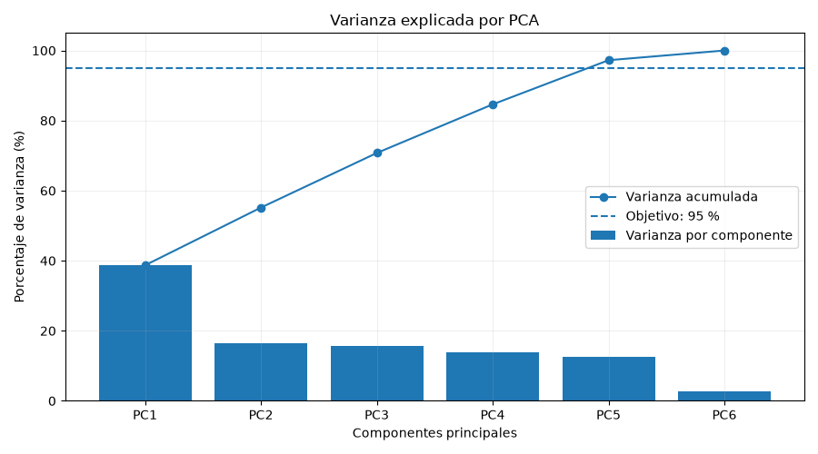
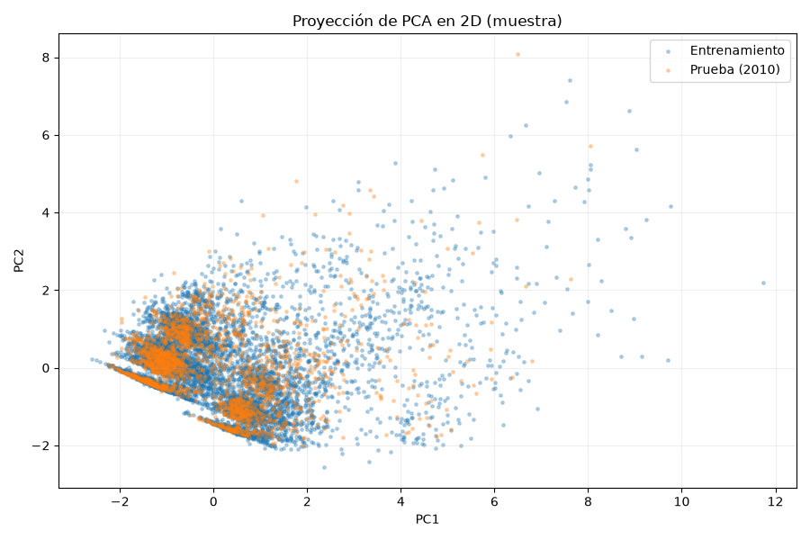

<div style="text-align: left;">
  
</div>

# Práctica 5: Normalización de datos, reducción de dimensionalidad y dashboard

**Alumnos:**

| Nombre Completo                 | Número de cuenta |
|---------------------------------| --- |
| Diego Arturo Gúzman Ramírez     | 321182324 |
| Oscar Palacios Gónzalez         | 321095572 |
| Gustavo Adrián Murillo Espinosa | 317011375 |
| Diego Hazael Vega Alonso        | 321301183 |

Esta prctica tiene como objetivo preparar y explorar datos de consumo eléctrico doméstico mediante técnicas de preprocesamiento, normalización numérica y reducción de dimensionalidad. Se utiliza el conjunto de datos Individual Household Electric Power Consumption, que contiene más de dos millones de mediciones registradas a lo largo del tiempo.

La práctica contempla la limpieza de datos, el tratamiento de valores faltantes, la eliminación de duplicados y la conversión de tipos de datos. Posteriormente, se aplica normalización numérica, se identifican variables redundantes mediante el coeficiente de correlación de Pearson y se emplea el Análisis de Componentes Principales (PCA) para representar la información en menos dimensiones.

Finalmente, se desarrolla un dashboard interactivo con indicadores, gráficas, tablas y filtros para explorar el comportamiento del consumo eléctrico y dar a conocer los hallazgos.

## Dataset original

Fuente: [Individual Household Electric Power Consumption, UCI Machine Learning Repository](https://archive.ics.uci.edu/dataset/235/individual+household+electric+power+consumption).

Según UCI, el conjunto contiene 2,075,259 registros y 9 columnas, con mediciones
por minuto de un hogar en Sceaux, Francia, entre diciembre de 2006 y noviembre de
2010. Es una serie temporal multivariada asociada a regresión y agrupamiento.

### Descarga y ubicación

1. Abrir la página de UCI indicada arriba y pulsar **Download** para descargar el
   ZIP.
2. Descomprimir el archivo y colocar `household_power_consumption.txt` en
   `proyecto/data/data-raw/`, desde la raíz del repositorio.
3. Conservar este TXT sin modificar. Los resultados del preprocesamiento se
   guardarán por separado en `proyecto/data/data-processed/`.

El TXT original está excluido de Git mediante `.gitignore`; cada integrante/profesor debe descargarlo para reproducir el proyecto.

### Formato y variables

El TXT tiene encabezado, utiliza punto y coma (`;`) como separador y punto (`.`)
como separador decimal. La fecha sigue el formato `dd/mm/yyyy` y la hora,
`hh:mm:ss`; en el archivo original, el día y el mes también aparecen con un solo
dígito, sin cero inicial, por ejemplo `1/1/2007`.

| Columna | Descripción | Unidad o formato |
|---|---|---|
| `Date` | Fecha de la medición | `dd/mm/yyyy` |
| `Time` | Hora de la medición | `hh:mm:ss` |
| `Global_active_power` | Potencia activa media por minuto | kW |
| `Global_reactive_power` | Potencia reactiva media por minuto | kW, según la ficha de UCI |
| `Voltage` | Voltaje medio por minuto | V |
| `Global_intensity` | Intensidad de corriente media por minuto | A |
| `Sub_metering_1` | Energía activa medida en la cocina | Wh |
| `Sub_metering_2` | Energía activa medida en el área de lavado | Wh |
| `Sub_metering_3` | Energía activa del calentador de agua y aire acondicionado | Wh |

UCI advierte que existen valores faltantes y describe campos vacíos.

## Preparación del entorno

Se requiere Python con los módulos
`venv` y `pip` disponibles.

Ejecutar los siguientes comandos desde la raíz del repositorio
(`Practica5_Norma_PCA/`), que contiene la carpeta `proyecto/`:

```bash
python3 -m venv .venv
source .venv/bin/activate
python -m pip install -r proyecto/requirements.txt
```

Si el entorno ya existe, basta con activarlo y ejecutar la instalación de
dependencias. En una terminal nueva, volver a activarlo con:

```bash
source .venv/bin/activate
```

Para salir del entorno:

```bash
deactivate
```

## Carga, inspección inicial y preprocesamiento

Desde la raíz del repositorio, con el entorno virtual activado:

```bash
python proyecto/src/cleaning/preprocessing.py
```

El programa muestra primero la inspección del dataset original y después ejecuta
automáticamente la conversión de tipos, la deduplicación y el tratamiento de
faltantes. Después valida el resultado, lo guarda en
`proyecto/data/data-processed/household_power_consumption_clean.csv` y muestra
la comparación con el estado inicial.

### Resultados de la inspección inicial

Diagnóstico obtenido sobre `household_power_consumption.txt` antes de la limpieza:

| Indicador | Resultado |
|---|---|
| Filas | 2,075,259 |
| Columnas | 9 |
| Primera fecha y hora válida | 2006-12-16 17:24:00 |
| Última fecha y hora válida | 2010-11-26 21:02:00 |
| Filas con al menos un faltante | 25,979 (1.251844 %) |
| Filas duplicadas completas, después de la primera | 0 |
| Marcas temporales válidas repetidas, después de la primera | 0 |
| Fechas u horas faltantes o inválidas | 0 |

Tipos tras la carga y valores faltantes por columna. Los porcentajes se calculan
sobre las 2,075,259 filas:

| Columna | Tipo | Faltantes | Porcentaje |
|---|---|---:|---:|
| `Date` | string | 0 | 0.000000 % |
| `Time` | string | 0 | 0.000000 % |
| `Global_active_power` | float64 | 25,979 | 1.251844 % |
| `Global_reactive_power` | float64 | 25,979 | 1.251844 % |
| `Voltage` | float64 | 25,979 | 1.251844 % |
| `Global_intensity` | float64 | 25,979 | 1.251844 % |
| `Sub_metering_1` | float64 | 25,979 | 1.251844 % |
| `Sub_metering_2` | float64 | 25,979 | 1.251844 % |
| `Sub_metering_3` | float64 | 25,979 | 1.251844 % |

Estadísticas descriptivas en las unidades originales. Cada variable numérica
tiene 2,049,280 observaciones válidas; los faltantes se excluyen del cálculo.

| Variable | Media | Desv. estándar | Mínimo | Q25 | Mediana | Q75 | Máximo |
|---|---:|---:|---:|---:|---:|---:|---:|
| `Global_active_power` | 1.091615 | 1.057294 | 0.076000 | 0.308000 | 0.602000 | 1.528000 | 11.122000 |
| `Global_reactive_power` | 0.123714 | 0.112722 | 0.000000 | 0.048000 | 0.100000 | 0.194000 | 1.390000 |
| `Voltage` | 240.839858 | 3.239987 | 223.200000 | 238.990000 | 241.010000 | 242.890000 | 254.150000 |
| `Global_intensity` | 4.627759 | 4.444396 | 0.200000 | 1.400000 | 2.600000 | 6.400000 | 48.400000 |
| `Sub_metering_1` | 1.121923 | 6.153031 | 0.000000 | 0.000000 | 0.000000 | 0.000000 | 88.000000 |
| `Sub_metering_2` | 1.298520 | 5.822026 | 0.000000 | 0.000000 | 0.000000 | 1.000000 | 80.000000 |
| `Sub_metering_3` | 6.458447 | 8.437154 | 0.000000 | 0.000000 | 1.000000 | 17.000000 | 31.000000 |

El problema de calidad identificado es la ausencia simultánea de las siete
mediciones en 25,979 filas. La carga reconoce `?` y campos vacíos como faltantes. No se detectaron duplicados ni fechas u horas inválidas en esta inspección.

## Criterios de limpieza

Estos criterios guían el preprocesamiento. La conversión de tipos, el orden
temporal, la deduplicación y el tratamiento de faltantes.

### Evidencia para decidir el tratamiento de faltantes

Se revisó la continuidad temporal y se agruparon las filas con las siete
mediciones ausentes en bloques consecutivos. El archivo está ordenado y el
intervalo entre registros consecutivos es de un minuto, sin instantes ausentes
en el original. Existen 71 bloques de mediciones faltantes y ninguna fila con
faltantes parciales. Los cinco bloques más largos son:

| Inicio | Fin | Registros sin mediciones |
|---|---|---:|
| 2010-08-17 21:02:00 | 2010-08-22 21:27:00 | 7,226 |
| 2010-09-25 03:56:00 | 2010-09-28 19:12:00 | 5,237 |
| 2007-04-28 00:21:00 | 2007-04-30 14:23:00 | 3,723 |
| 2009-06-13 00:30:00 | 2009-06-15 07:34:00 | 3,305 |
| 2010-01-12 14:53:00 | 2010-01-14 19:01:00 | 3,129 |

### Reglas que se aplicarán

| Aspecto | Criterio | Justificación |
|---|---|---|
| Faltantes completos | Retirar únicamente las filas con las siete mediciones ausentes y registrar cuántas se retiran. | No aportan mediciones observadas; existen tramos de varios días y su imputación introduciría valores estimados durante periodos prolongados. |
| Faltantes parciales | Si aparecen en otra versión del archivo, detendriamos la preparación de la salida y revisariamos la estrategia antes de tratarlos. | La inspección actual no encontró este caso y no justifica una regla de imputación adicional. |
| Duplicados completos | Conservar la primera aparición de cada fila idéntica y registrar las repeticiones eliminadas. | Repetir exactamente el mismo registro no aporta información adicional. Actualmente se esperan cero eliminaciones por este criterio. |
| Misma fecha y hora con mediciones distintas | Detectar el conflicto y detener la preparación de la salida para su revisión. | Compartir instante no basta para decidir qué medición conservar ni justifica promediarlas automáticamente. |
| Fechas y horas | Interpretar día/mes/año y `hh:mm:ss`, admitiendo día y mes con uno o dos dígitos, y sustituir `Date` y `Time` por una columna temporal `Datetime`. | Respeta el formato real del archivo y permite ordenar y filtrar sin ambigüedad. |
| Valores temporales o numéricos inválidos | Detectarlos y detener la preparación de la salida para su revisión, incluyendo mediciones no finitas. | Una conversión fallida no debe confundirse con los faltantes originales ni eliminarse silenciosamente. |
| Tipos numéricos | Mantener las siete mediciones como `float64`, con sus nombres y unidades originales. | Permite representar las mediciones decimales y utilizarlas en los pasos siguientes. |
| Variables cualitativas | Documentar que la normalización de mayúsculas, espacios y acentos no aplica al esquema actual. | Las columnas corresponden a fecha, hora y mediciones; no hay categorías textuales que requieran esa normalización. |
| Orden temporal | Ordenar por `Datetime` de forma ascendente conservando los instantes originales. | La secuencia temporal es necesaria para los pasos posteriores. |
| Valores extremos | Conservar las mediciones extremas que tengan tipos válidos. | Un extremo no es, por sí solo, un error de registro; su análisis corresponde a la etapa de normalización. |

### Resultado validado y comparación antes/después

| Indicador | Original cargado | Dataset limpio guardado |
|---|---:|---:|
| Filas | 2,075,259 | 2,049,280 |
| Columnas | 9 | 8 |
| Filas con mediciones faltantes | 25,979 | 0 |
| Valores faltantes | 181,853 | 0 |
| Filas duplicadas completas | 0 | 0 |
| Marcas temporales repetidas | 0 | 0 |

El rango temporal se conserva: desde `2006-12-16 17:24:00` hasta
`2010-11-26 21:02:00`. El resultado mantiene el orden cronológico, los 71 huecos
temporales y las unidades originales. La reducción de nueve a ocho columnas se
debe a la sustitución de `Date` y `Time` por `Datetime`.

## Normalización de variables numéricas

Se analizaron las siete variables cuantitativas del dataset limpio, considerando sus escalas, unidades de medición y presencia de valores atípicos mediante el rango intercuartílico (IQR).

Los resultados mostraron diferencias importantes entre las escalas de las variables, así como mediciones extremas. Destaca `Sub_metering_1`, cuyo IQR es igual a cero debido a la concentración de registros sin consumo. Los valores extremos se conservaron, ya que pueden representar eventos reales de consumo eléctrico y no necesariamente errores.

### Técnica seleccionada

Se eligió la **estandarización Z-score** en lugar de Min-Max, debido a que las variables presentan diferentes escalas y valores extremos que podrían comprimir gran parte de las observaciones al utilizar mínimos y máximos.

Z-score permite transformar las variables para obtener una media de cero y desviación estándar de uno en el conjunto de entrenamiento, facilitando su comparación y posterior utilización en PCA. Se considera que esta técnica también es sensible a valores atípicos.

### Prevención de fuga de información temporal

Para evitar utilizar información futura durante la normalización, se estableció el **1 de enero de 2010 como fecha de corte**, dividiendo los registros cronológicamente:

| Conjunto | Periodo | Registros |
|---|---|---:|
| Entrenamiento | Diciembre de 2006 a diciembre de 2009 | 1,591,886 |
| Prueba | Enero a noviembre de 2010 | 457,394 |

La media y desviación estándar de cada variable se calcularon exclusivamente con el conjunto de entrenamiento mediante `StandardScaler.fit()`. Posteriormente, ambos conjuntos se transformaron utilizando los mismos parámetros con `transform()`.

Esta división temporal es una decisión metodológica del equipo y no una fecha exigida por el enunciado.

### Resultados de la normalización

Se verificó que las siete variables estandarizadas presentan medias aproximadamente iguales a cero y desviaciones estándar iguales a uno en el conjunto de entrenamiento.

Las medias del conjunto de prueba pueden diferir de cero, ya que se utilizan los parámetros obtenidos del entrenamiento sin recalcularlos.

El procedimiento se encuentra documentado en `notebooks/normalizacion.ipynb` y genera:

- `household_power_consumption_zscore.csv`: dataset con las siete variables estandarizadas y su columna temporal.
- `zscore_parametros.csv`: medias, desviaciones estándar, fecha de corte y cantidad de registros utilizados.

## Reducción de dimensionalidad mediante correlación de Pearson

Se calculó la matriz de correlación de Pearson entre las siete variables numéricas utilizando únicamente los registros anteriores al 1 de enero de 2010. Esto evita incorporar información del conjunto de prueba en las decisiones de selección de variables.

Se generó una matriz de correlación de 7 × 7 y un mapa de calor para identificar relaciones lineales y posibles redundancias.

### Resultados principales

| Variables | Correlación aproximada |
|---|---:|
| `Global_active_power` y `Global_intensity` | 0.999 |
| `Global_active_power` y `Sub_metering_3` | 0.629 |
| `Voltage` y `Global_intensity` | -0.409 |

La correlación más alta corresponde a `Global_active_power` y `Global_intensity`, indicando una relación lineal positiva casi perfecta y una posible redundancia entre ambas variables.

### Criterio de selección

Se estableció un umbral de **correlación absoluta mayor o igual a 0.90**, considerando relaciones positivas y negativas. Este criterio permite identificar variables altamente relacionadas sin descartar aquellas que presentan correlaciones moderadas.

Con base en los resultados, se decidió:

- **Conservar:** `Global_active_power`, `Global_reactive_power`, `Voltage`, `Sub_metering_1`, `Sub_metering_2` y `Sub_metering_3`.
- **Descartar:** `Global_intensity`, debido a su alta correlación con `Global_active_power`, variable que representa directamente la potencia activa consumida.

De esta manera, se propone reducir de siete a **seis variables numéricas**, conservando las mediciones relevantes para el análisis posterior.

### Archivos y continuidad del proyecto

El analisis completo se encuentra en `notebooks/pearson.ipynb`. Se generan los siguientes archivos:

| Archivo | Contenido |
|---|---|
| `matriz_pearson_entrenamiento.csv` | Matriz de correlaciones entre las siete variables. |

El notebook permite generar opcionalmente un CSV con las seis variables seleccionadas.

**Para la siguiente etapa de PCA**, se dispone de las variables estandarizadas, la selección realizada mediante Pearson y la división temporal utilizada. El dataset original y el dataset limpio permanecen sin modificaciones.


## Reducción de dimensionalidad mediante PCA

Se aplico PCA con el objetivo de reducir la dimensionalidad del dataset, conservando la mayor cantidad posible de varianza.

Para realizar el análisis se utilizaron las seis variables numéricas conservadas después de aplicar la correlación de Pearson, las cuales ya habían sido estandarizadas mediante Z-score.

### Aplicación de PCA

Antes de aplicar PCA, se verificó que las variables del conjunto de entrenamiento tuvieran medias cercanas a cero y desviaciones estándar cercanas a uno.

Se utilizo la implementación PCA de scikit-learn, ajustandola unicamente con los registros anteriores al 1 de enero de 2010.

Esto permitió calcular los componentes principales sin utilizar información del conjunto de prueba.

Inicialmente se calcularon seis componentes principales, uno por cada variable numerica utilizada.

### Varianza explicada y selección de componentes

Se calculo la varianza explicada individual y acumulada de cada componente principal.

Se establecio como criterio conservar al menos el 95% de la varianza total del conjunto de entrenamiento.

Los resultados fueron:

| Componente | Varianza explicada | Varianza acumulada |
|---|---:|---:|
| PC1 | 38.70% | 38.70% |
| PC2 | 16.47% | 55.16% |
| PC3 | 15.59% | 70.75% |
| PC4 | 13.87% | 84.63% |
| PC5 | 12.61% | 97.23% |
| PC6 | 2.77% | 100% |

Se decidio conservar las primeras cinco componentes principales, ya que juntas explican el 97.23% de la varianza, superando el criterio establecido del 95%.

La sexta componente fue descartada porque solamente explica el 2.77% de la varianza total.

De esta manera, se consiguió representar las seis variables numericas mediante cinco componentes principales.

### Grafica de varianza explicada

Se generó una grafica (scree plot) que muestra la varianza explicada por cada componente y la varianza acumulada.



La gráfica permite observar que con cinco componentes se supera el 95% de la varianza acumulada.

### Interpretación de los loadings

Se analizaron los loadings para identificar que variables originales tienen mayor relación con cada componente principal.

Los resultados principales fueron:

- **PC1:** Se relaciona principalmente con Global_active_power, Sub_metering_3 y Voltage. Representa un patrón asociado con la potencia activa y las submediciones, en contraste con el voltaje.

- **PC2:** Se relaciona principalmente con Global_reactive_power, Sub_metering_3 y Sub_metering_2. Refleja diferencias entre estas mediciones.

- **PC3:** Destacan Sub_metering_1 y Sub_metering_2, presentando relaciones en sentidos opuestos.

- **PC4:** Se relaciona principalmente con Global_reactive_power, Sub_metering_1 y Sub_metering_2.

- **PC5:** Está asociada principalmente con Voltage, que presenta el loading de mayor magnitud en esta componente.

### Proyección en dos dimensiones

Se realizo una proyección de los datos utilizando las dos primeras componentes principales (PC1 y PC2).

Para facilitar la visualización, se utilizo una muestra de 10,000 registros, diferenciando los datos de entrenamiento y prueba mediante colores.



En la gráfica se observa una concentración importante de registros en una misma región, así como algunos puntos alejados de la concentración principal.

Los datos de entrenamiento y prueba presentan una superposición considerable y no se observan grupos claramente separados.

Las primeras dos componentes explican conjuntamente el 55.16% de la varianza, por lo que la grafica muestra solamente una parte de la variabilidad total del dataset.

### Dataset final

Despues de seleccionar las cinco componentes principales, se incorporaron al dataset procesado, conservando también las seis variables numericas estandarizadas.

El dataset final contiene:

- 2,049,280 registros.
- 12 columnas.
- 6 variables numéricas normalizadas.
- 5 componentes principales (PC1 a PC5).
- La columna temporal Datetime.
- 0 valores faltantes.

La variable Global_intensity fue descartada conforme a la decisión tomada en el analisis de correlación de Pearson.

El archivo final se guardó en:

`data/data-processed/household_power_consumption_final.csv`

Este dataset conserva las variables originales seleccionadas y las componentes principales, permitiendo utilizar estas últimas como una representación de menor dimensionalidad en futuros modelos de aprendizaje automático.

### Ejecución de PCA

Todo el procedimiento de PCA se encuentra implementado en:

`notebooks/pca.ipynb`

Para ejecutarlo, primero deben haberse generado los datos normalizados mediante `normalizacion.ipynb`.

Despues, se abre `pca.ipynb` en Jupyter o VS Code y se ejecutan las celdas en orden.

El notebook genera los siguientes archivos:

| Archivo | Descripción |
|---|---|
| household_power_consumption_final.csv | Dataset final con las componentes principales |
| pca_varianza_explicada.csv | Resultados de la varianza explicada y acumulada |
| pca_loadings.csv | Loadings de las componentes principales |
| pca_scree_plot.png | Grafica de varianza explicada |
| pca_proyeccion_2d.png | Proyección de los datos en dos dimensiones |

Los archivos CSV se guardan en `data/data-processed/` y las graficas en `notebooks/figures/`.